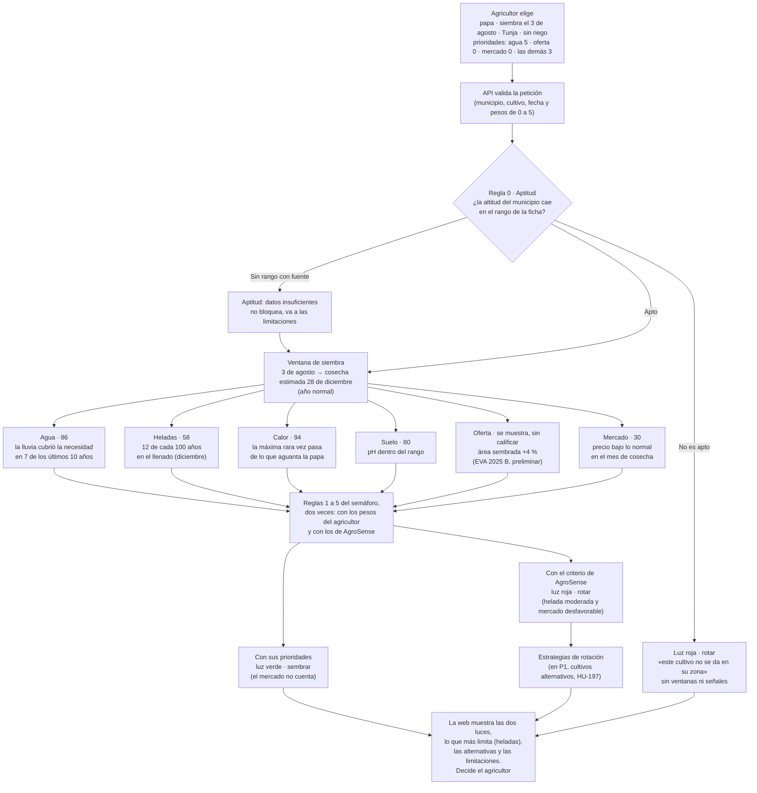

# Flujo de decisión: un ejemplo paso a paso

Caso ilustrativo (papa, siembra el 3 de agosto, Tunja, sin riego). El agricultor vende a un comprador fijo y le pone peso 0 al mercado y a la oferta; le importa mucho el agua (peso 5). **Los números son de ejemplo, no son datos reales.** Desde el 15 de noviembre de 2026 (decisión 17, propuesta) la oferta se muestra y no se califica, y el mercado se califica con la anomalía estacional del precio. Tunja es de la región piloto, que es un supuesto hasta que el reto confirme la región (decisión 11). Las reglas completas están en `specs/01-reglas.md`.

Todo se evalúa sobre una **ventana de siembra**: de la fecha de siembra a la cosecha estimada de ese cultivo. Es historia de la zona, no un pronóstico.

## Qué decide cada subsistema

| Paso | Subsistema | Qué hace | Qué NO hace |
|---|---|---|---|
| 1 | W1 | Ofrece solo combinaciones válidas del catálogo: municipio, cultivo, cuándo sembrar, si hay riego y, si el agricultor quiere, sus prioridades (empiezan en las de AgroSense) | Permitir opciones fuera del catálogo ni enviar las prioridades a guardar sin cuenta (con cuenta van al perfil; sin cuenta, quedan en el navegador) |
| 2 | M6 (API) | Valida la entrada; 422 si es inválida (también con un peso fuera de 0 a 5 o todos en 0) | Contener lógica de decisión |
| 3 | M1 | Regla 0: comprueba la aptitud del cultivo en la zona. Si no es apto, termina aquí con luz roja y acción rotar | Evaluar ventanas de un cultivo que no es apto |
| 4 | M10 | Calcula la ventana: las etapas por semana y la cosecha estimada con un año normal | Presentar la cosecha estimada como pronóstico |
| 5 | M1 (con M7) | Califica de 0 a 100 agua, heladas, calor, suelo, oferta y mercado con una curva por cultivo, y saca el nivel de la calificación. El agua sale del balance hídrico, con la textura del suelo y según haya riego. Si un indicador tiene varias fuentes, usa la de `sources.yaml` y entrega las demás para contrastar | Dar nivel a una señal sin datos ni mezclar fuentes |
| 6 | M2 | Aplica las reglas del semáforo con los pesos del agricultor y con los de AgroSense, elige una acción para cada uno, dice qué señales cuentan y cuál limita más. Con «otra ventana», ordena las ventanas y entrega las mejores; con «rotar», busca cultivos alternativos | Promediar señales para decidir la luz, dejar que un peso 0 esconda un riesgo grave de clima, ni dejar que el promedio compense un factor muy malo |
| 7 | M3 | Genera secuencias, filtra las inválidas y las que no son aptas para la zona, y puntúa el resto | Puntuar secuencias inválidas |
| 8 | M4 | Convierte la aptitud, las señales, las reglas y las calificaciones en razones con plantillas | Mencionar causas no evaluadas |
| 9 | W2–W4 | Muestra la aptitud, las dos luces si difieren, las señales con su calificación, lo que más limita, las fuentes juntas, las limitaciones, las mejores ventanas, las alternativas y el ranking | Usar solo color para el estado ni ordenar al agricultor qué hacer |

## Cómo se califica cada señal

Cada señal recibe de 0 a 100 con una curva por cultivo, al estilo EcoCrop de la FAO: 100 dentro del rango óptimo del cultivo, 0 fuera de sus límites absolutos y una recta entre ambos. El nivel sale de la calificación: 70 a 100 `favorable`, 40 a 69 `moderate`, 0 a 39 `unfavorable`. Es crítica si baja del umbral crítico de `thresholds.yaml`. Sin datos o sin el límite de la ficha con fuente, no se califica (R1).

## Los pesos

Cada señal tiene un peso de 0 a 5. AgroSense propone los suyos (`weights.yaml`) y el agricultor los cambia.

| Peso | Efecto en la luz |
|---|---|
| 0 | La señal se muestra, pero no cuenta. Excepción: agua, heladas o calor críticos cuentan siempre (en P1, también `excess_rain` crítico) |
| 1 a 3 | Cuenta normal |
| 4 o 5 | Un `moderate` cuenta como `unfavorable` |

## Las reglas, en orden

Se aplican dos veces: con los pesos del agricultor (`overall`) y con los de AgroSense (`overall_default`). «Señal que cuenta» es la de peso mayor que 0, más los riesgos graves de clima.

0. **Aptitud.** Si la altitud del municipio queda fuera del rango de la ficha, el cultivo no es apto: luz `red`, acción `rotate`, sin ventanas. Si la ficha no tiene ese rango con fuente, la aptitud es `insufficient_data`: no bloquea y va a las limitaciones.
1. Si `water` cuenta y no está disponible, la luz es `not_evaluable` y la acción es `review_data`. Sin datos de `supply`, se calcula sin ella, como si su peso fuera 0.
2. Si alguna señal que cuenta es `unfavorable` y crítica, o dos señales que cuentan son `unfavorable`, la luz es `red`.
3. Si al menos una señal que cuenta califica, ninguna señal que cuenta es `unfavorable` y `water` es `favorable` (o no cuenta), la luz es `green`.
   - Sin ninguna señal que cuente y califique (por ejemplo, con peso solo en la oferta y el mercado, sin datos), la luz es `yellow` y la acción `other_window`, con una razón que lo explica: no hay evidencia de riesgo ni de que la ventana sea buena (R5; HU-074, aprobado por Felipe el 14 de noviembre de 2026, `docs/registro-de-decisiones.md`).
4. En cualquier otro caso, la luz es `yellow`.
5. `frost`, `heat`, `soil`, `market` y las señales del P1 sin datos nunca cambian la luz, pero van a las limitaciones. `not_applicable` tampoco la cambia.

| Luz | Acción |
|---|---|
| `green` | `sow` |
| `yellow` | `rotate` si `soil`, `supply` o `market` son `unfavorable` (cambiar de fecha no los arregla); si no, `other_window` |
| `red` | `other_window` si todas las señales desfavorables son de clima (`water`, `frost`, `heat` y, en P1, `excess_rain`); `rotate` si alguna es `soil`, `supply` o `market`, o si el cultivo no es apto |
| `not_evaluable` | `review_data` |

Con `other_window` la respuesta trae las mejores ventanas; con `rotate`, hasta tres cultivos alternativos. Todo es informativo: decide el agricultor.

## Por qué salen dos luces

0. La papa es apta para Tunja: la temperatura media anual del municipio cae dentro del rango de su ficha (decisión 13).
1. Hay datos de agua, así que el caso es evaluable.
2. El agua califica 86 (favorable), el calor 94 y el suelo 80 (favorables). Las heladas califican 58: moderadas, no desfavorables, y no críticas.
3. El mercado califica 30: desfavorable, pero nunca crítico. En los años de la historia, el precio mayorista del mes de cosecha suele estar por debajo de lo normal.
4. La oferta se muestra (el área sembrada de EVA del semestre B, preliminar) y no se califica: no cambia la luz.
5. **Con el criterio de AgroSense** (los pesos de `weights.yaml`; la helada pesa 4): la helada moderada cuenta como desfavorable y el mercado es desfavorable: dos desfavorables, regla 2, rojo. Como una de ellas es el mercado, cambiar de fecha no lo arregla: la acción es `rotate`, y la web lleva a las estrategias de rotación.
6. **Con sus prioridades** (mercado en 0): el mercado no cuenta. El agua es favorable y ninguna señal que cuenta es desfavorable: regla 3, verde y `sow`.
7. Lo que más limita la ventana entre las señales que cuentan son las heladas (58). La web lo marca.
8. La web muestra las dos luces, el mercado con el rótulo «No cuenta para la luz con sus prioridades» y la oferta como dato. La decisión es del agricultor.

## Qué cambia en otros casos

| Caso | Resultado |
|---|---|
| El mismo cultivo en un municipio de la costa | Regla 0: no es apto. Luz `red`, acción `rotate`, sin ventanas ni señales |
| Helada crítica en la floración, con agua y oferta favorables | Luz `red` (regla 2). Todas las señales desfavorables son de clima: acción `other_window`, con `best_windows` |
| La misma helada crítica, con peso 0 en heladas | Sigue en `red`: un riesgo grave de clima cuenta siempre |
| Heladas moderadas, con peso 5 en heladas | El `moderate` cuenta como `unfavorable`: la luz con sus prioridades puede bajar frente a la de AgroSense |
| Falta de lluvia, sin riego | `water` desfavorable; si es crítica, luz `red` |
| La misma falta de lluvia, con riego | `water` no es desfavorable por eso: la razón dice cuánto riego haría falta, como estimación |
| El mismo cultivo y la misma lluvia, en un suelo arenoso | El suelo retiene menos agua: el déficit puede ser mayor y la calificación del agua, más baja |
| Oferta con dos fuentes que no coinciden (P1) | Se ven juntas; la de `sources.yaml` es la que se usa y la otra va «para contrastar» |
| Una ventana con el mejor promedio y una señal crítica | Se marca `high_risk`: va después de todas las que tienen calificación y no son de alto riesgo, y no entra en `best_windows` |
| Sin datos de agua, cuando el agua cuenta | Luz `not_evaluable`, acción `review_data`. Con peso 0 en el agua, la luz no queda en `not_evaluable` |
| Sin datos de oferta | La oferta no se califica: no cambia nada, y «sin datos de oferta» queda en las limitaciones |

## Cómo se ordenan las ventanas

Es el método de la FAO para aptitud de cultivos: primero lo que más limita, después lo que prefiere el agricultor.

1. Cada señal disponible se califica de 0 a 100. Una señal sin datos o que no aplica no califica y va a las limitaciones.
2. **Factor limitante:** cada ventana vale lo que vale su señal más baja entre las que cuentan. Una ventana con un factor muy malo nunca queda arriba, por buenos que sean los demás.
3. **Prioridades:** entre ventanas cuyo factor limitante cae en la misma decena (por ejemplo, de 60 a 69), ordena el promedio de las calificaciones ponderado por los pesos (los del agricultor o, si no los cambió, los de AgroSense).
4. Una ventana con una señal crítica que cuenta es de alto riesgo: va después de todas las que tienen calificación y no son de alto riesgo, y nunca entra entre las mejores.
5. En empate, gana la ventana más temprana.
6. Se muestran todas las ventanas con la calificación de cada señal y su factor limitante. La decisión es del agricultor.

El orden sirve para comparar fechas. No decide el semáforo.
