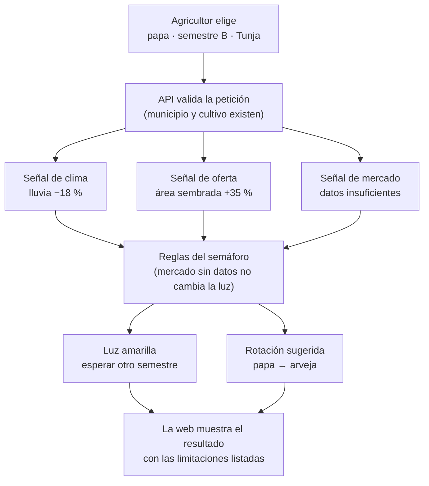

# Flujo de decisión: un ejemplo paso a paso

Caso ilustrativo (papa, semestre B, Tunja). **Los números son de ejemplo, no son datos reales.**

## Qué decide cada subsistema

| Paso | Subsistema | Qué hace | Qué NO hace |
|---|---|---|---|
| 1 | W1 | Ofrece solo combinaciones válidas del catálogo | Permitir opciones fuera del catálogo |
| 2 | M6 (API) | Valida la entrada; 422 si es inválida | Contener lógica de decisión |
| 3 | M1 | Evalúa clima, oferta y mercado con umbrales de configuración | Dar nivel a una señal sin datos |
| 4 | M2 | Aplica las reglas ordenadas del semáforo y elige la acción | Promediar señales |
| 5 | M3 | Genera secuencias, filtra las inválidas, puntúa el resto | Puntuar secuencias inválidas |
| 6 | M4 | Convierte señales, reglas y puntajes en razones con plantillas | Mencionar causas no evaluadas |
| 7 | W2–W4 | Muestra semáforo, razones, limitaciones y ranking | Usar solo color para el estado |

## Por qué sale amarillo

1. El clima es favorable.
2. La oferta es desfavorable (se está sembrando mucho más que antes).
3. El mercado no tiene datos: no cambia la luz, pero se agrega a las limitaciones.
4. Con una sola señal desfavorable que no es crítica y el clima favorable, la regla 4 del semáforo («en cualquier otro caso, amarillo») aplica, y la acción es esperar otro semestre.
